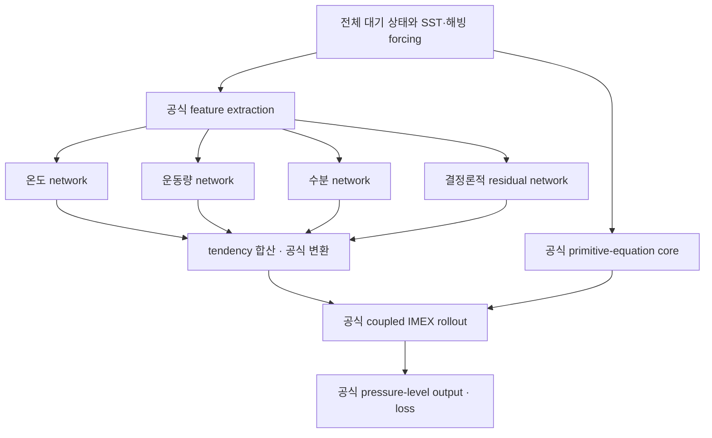

# NeuralGCM for Expert

공식 **NeuralGCM 1.2.2**의 learned physics를 온도·운동량·수분·잔차 network로
분해하는 결정론적 실험입니다. 실제 NeuralGCM/Dinosaur dynamics core와 원래
IMEX 적분기, pressure-level 입력·출력을 사용합니다. SDE, diffusion, noise
sampling, 별도의 memory model은 없습니다.

구현과 소규모 실행 검증을 제공하는 연구 코드입니다. **ERA5 본 학습 결과나
성능 향상을 보고하는 저장소는 아닙니다.** 공식 모델 가중치와 사용자 자료는
포함하지 않습니다. 설계 설명은 [docs/design.md](docs/design.md), upstream
버전·라이선스는 [UPSTREAM.md](UPSTREAM.md), 실제 실행 범위는
[docs/validation.md](docs/validation.md)를 참고하세요.

## 세 가지 비교군

| mode | learned physics | native memory | 목적 |
|---|---|---|---|
| `baseline` | 공식 network 그대로 | 공식 checkpoint 그대로 | 변경하지 않은 deterministic NeuralGCM |
| `memoryless` | 공식 단일 network | 제거 | memory 제거 효과를 분리하는 기준선 |
| `experts` | 온도 + 운동량 + 수분 + 결정론적 잔차 | 제거 | 이번 분해 실험 |

`experts --no-residual`도 지원합니다. 공식 deterministic checkpoint에도 native
memory가 있으므로, 원본 baseline을 “memory-free”라고 부르지 않습니다.
변경된 network는 새로 초기화하고 구조가 같은 parameter만 이식합니다.
저장되는 JSON/체크포인트 metadata에서 이식·재초기화 내역을 확인할 수 있습니다.
분해 모델은 학습 후 비교해야 합니다.

## 구조와 loss



각 network는 **전체 입력**을 받으며, 자기 변수의 tendency만 출력합니다.
온도→바람, 바람→수분 같은 교차 의존성을 끊지 않습니다. wind network 출력은
공식 변환을 거쳐 divergence/vorticity tendency가 됩니다. 기압 tendency의
기본 mask는 공식 설정을 유지하며, 기압 변화는 core에서 결합되어 계산됩니다.
SST와 해빙은 외부 forcing이며 해양 ODE를 새로 추가하지 않습니다.

$$F(x,c)=F_{core}(x)+P_T f_T(x,c)+P_{uv}f_{uv}(x,c)+P_q f_q(x,c)+r(x,c).$$

$$\mathcal L=\mathcal L_{rollout}
+\lambda_v\|F-\widehat{\dot x}\|_s^2
+\lambda_a\|D_xF[F]-\widehat{\ddot x}\|_s^2
+\lambda_r\|\theta_{residual}\|^2.$$

기본값은 공식 solver를 통과한 normalized rollout MSE와 작은 잔차 parameter
정규화입니다. 선택적 ODE 항은 **core의 explicit + implicit 항과 모든 learned
tendency를 합친 실제 RHS**에 JAX JVP를 적용합니다. 단순히 각 식을 자기 변수로만
미분하지 않습니다. 원래 1차 ODE와 적분기를 유지합니다.

`D_xF[F]`에는 `sim_time'=1`을 통한 명시적 시간 변화가 포함됩니다. 외부 forcing은
이 미분에서 고정하며, `native_acceleration(..., processed_forcing_tangent=...)`를
사용하면 명시한 forcing 변화율도 포함할 수 있습니다. 수치 step filter와
finite-step IMEX map의 미분은 이 연속 RHS와 구별합니다.

온도 network를 곧바로 “복사”, 운동량 network를 “난류”로 식별할 수는 없습니다.
이는 변수별 분해이며, 과정별 식별에는 별도 정답·수지 제약이 필요합니다.
잔차는 `residual_scale*tanh(raw)`로 제한한 결정론적 미설명 tendency이며
**추출된 확률 noise라고 주장하지 않습니다.** 개별 head가 어떤 물리적 다양체의
접벡터이거나 서로 직교한다는 가정도 하지 않습니다.

## 설치

```bash
git clone https://github.com/nayehyeon61-glitch/neural_gcm_for_expert.git
cd neural_gcm_for_expert
python3.12 -m venv .venv
source .venv/bin/activate
python -m pip install -e '.[test]'
python -m pytest -q
python examples/smoke_test.py
```

`pyproject.toml`은 실제 검증한 JAX/NeuralGCM/Dinosaur 버전을 고정합니다.
위 설치는 CPU용입니다. GPU 환경에서는 같은 JAX 0.7.2 버전의 CUDA 빌드를
설치하고 드라이버 호환성을 확인하세요. smoke test는 작은 공식 모듈을 통과하는
합성 검증이며, weather forecast skill 평가가 아닙니다.

공식 deterministic 2.8° checkpoint 예시:

```bash
mkdir -p checkpoints
curl -fL https://storage.googleapis.com/neuralgcm/models/v1/deterministic_2_8_deg.pkl \
  -o checkpoints/deterministic_2_8_deg.pkl
```

공식 가중치는 CC BY-SA 4.0이며 trusted pickle만 읽어야 합니다. 새로 생성한
expert 가중치도 upstream 가중치를 이식한다면 해당 조건을 고려해야 합니다.

## 자료와 입출력

공식 [data preparation](https://neuralgcm.readthedocs.io/en/latest/data_preparation.html)
절차로 **checkpoint의 정확한 격자와 pressure level**에 준비한 NetCDF/Zarr를
사용합니다. 코드가 0.25° ERA5를 임의로 축소하거나 결측값을 숨기지 않습니다.
`model.input_variables`와 `model.forcing_variables`가 최종 기준입니다.

| 종류 | 변수 / 차원 |
|---|---|
| 대기 입력·출력 | temperature, u_component_of_wind, v_component_of_wind, geopotential, specific_humidity, checkpoint가 요구하는 cloud ice/liquid |
| 대기 차원 | `(time, level, longitude, latitude)` |
| 외부 forcing | sea_surface_temperature, sea_ice_cover |
| forcing 차원 | `(time, longitude, latitude)` |
| 시각 | 증가하는 중복 없는 `datetime64`; 선택한 lead의 정확한 target 시각 필요 |

`PressureLevelModel.encode/advance/decode/unroll`, `inputs_from_xarray`,
`forcings_from_xarray`, `data_to_xarray`의 원래 API를 그대로 사용합니다.
`sim_time`은 API가 추가합니다. 압력면, 변수 단위, 축 순서를 맞춰야 합니다.
Training에는 초기 시점과 미래 정답이 필요합니다.

## 실험 실행

아래 `data/train.nc`, `data/validation.nc`, `data/test.nc`는 사용자가 준비한
서로 겹치지 않는 기간입니다. 모델 크기 때문에 실제 학습은 GPU에서 실행하세요.

```bash
# 공식 원본 기준선
ngcm-expert init --mode baseline \
  --checkpoint checkpoints/deterministic_2_8_deg.pkl \
  --data data/train.nc --output checkpoints/baseline.pkl

# 이번 전문가 실험 초기화
ngcm-expert init --mode experts \
  --checkpoint checkpoints/deterministic_2_8_deg.pkl \
  --data data/train.nc --output checkpoints/experts-init.pkl

# 별도 비교 실험에서는 --mode memoryless 또는 --mode experts --no-residual 사용
ngcm-expert train --checkpoint checkpoints/experts-init.pkl \
  --train-data data/train.nc --validation-data data/validation.nc \
  --steps 4 --interval 6h --epochs 10 --learning-rate 1e-4 \
  --output runs/experts

# 같은 test, 같은 forcing, 같은 초기화 간격으로 baseline과 각각 비교
ngcm-expert evaluate --checkpoint checkpoints/baseline.pkl \
  --data data/test.nc --steps 20 --interval 6h \
  --all-starts --stride 4 --output runs/eval-baseline
ngcm-expert evaluate --checkpoint runs/experts/best.pkl \
  --data data/test.nc --steps 20 --interval 6h \
  --all-starts --stride 4 --output runs/eval-experts
```

기본 학습 범위 `--scope physics`는 learned parameterization만 갱신합니다.
`--scope all`은 encoder/decoder를 포함합니다. `last.pkl`은 매 epoch 저장되며
validation을 지정하면 첫 validation 초기 시점의 normalized rollout MSE로
`best.pkl`을 선택합니다. 이는 전체 validation period의 최적 모델이라는 뜻은
아닙니다. 본 비교는 `--all-starts`로 여러 초기 시점에서 수행하세요.
checkpoint로 재시작하면 optimizer state는 새로 생성됩니다.

기본 scale은 training 자료에서만 추정합니다. 큰 자료에서는 미리 산출한
`--scales scales.json` 사용을 권장합니다. JSON은 모든 `model.input_variables`의
양의 **표준편차/물리 scale**을 포함해야 합니다. 분산을 넣지 않습니다.

### ODE 미분 loss를 켜는 경우

```bash
ngcm-expert train --checkpoint checkpoints/experts-init.pkl \
  --train-data data/train.nc --validation-data data/validation.nc \
  --steps 4 --interval 6h --epochs 10 \
  --native-scales native-scales.json \
  --tendency-weight 0.001 --acceleration-weight 0.0001 \
  --output runs/experts-ode
```

위 가중치는 실험 출발점이며 검증된 최적값이 아닙니다. `native-scales.json`은
`temperature_variation`, `vorticity`, `divergence`, `log_surface_pressure`,
`tracers/specific_humidity` 및 활성 cloud tracer 등의 **native 무차원 field
scale**을 포함해야 합니다. 모든 단위를 확인하여 학습 자료로 정하세요.
전후 3개 정답 상태를 고정된 초기 encoder로 encode한 다음 중앙 차분 target을
만듭니다. 6시간 차분은 순간 물리 acceleration의 정확한 정답이 아니므로,
우선 짧은 구간에서 작은 가중치로 비교하는 것이 좋습니다. ODE 항은 비용이
크며 원본 `baseline`의 memory 상태에는 적용하지 않습니다.

## 평가 출력과 범위

- `predictions.nc`: 단일 초기 시점에서는 공식 decoded 예측. 여러 초기 시점은
  메모리 사용을 줄이기 위해 기본적으로 초기화 좌표만 저장하며,
  `--store-predictions`를 추가하면 전체 init/lead 예측을 저장합니다.
- `metrics.nc`, `metrics.json`: 변수·기압면·lead별 RMSE, native T850/Z500/UV700/Q700.
- `--climatology climate.nc`: 외부에서 준비한 정합된 climatology로 ACC 추가.
- `--all-starts`: 초기 시점별 squared error를 합친 뒤 root를 취하는 집계.
- 기본 `--forcing-mode persistence`: 초기 SST·해빙 유지.
- `--forcing-mode dynamic`: 미래 관측 boundary를 제공하는 hindcast로 명시.

공식 reference metric과 같은 `horizontal.integrate/(4πR²)`를 사용합니다.
Gaussian grid에서 단순 cos(latitude)로 대체하지 않으며 lead 0은 점수에
포함하지 않습니다. 원 논문의 전체 WeatherBench2 데이터·평가 격자·기간을
재현했다고 주장하지 않습니다. 학습 기간, 초기 시점, forcing, 해상도, parameter
수와 학습 예산을 함께 맞춰 비교해야 합니다. 독립 tower를 여러 개 두므로
baseline보다 parameter 수가 커질 수 있습니다.

## 코드 위치

| 파일 | 역할 |
|---|---|
| `model.py` | checkpoint 변환, memory/randomness 제거, weight 이식·저장 |
| `mappings.py` | 독립 변수별 network와 bounded residual |
| `dynamics.py` | 실제 native coupled RHS와 JVP |
| `losses.py` | scale/면적 가중 loss와 중앙 차분 utility |
| `training.py` | 공식 solver를 통과하는 autodiff 학습 |
| `data.py`, `evaluation.py` | 공식 I/O와 평가 규약 |
| `cli.py` | init / train / evaluate 명령 |

Python에서 다시 읽을 때는 `neuralgcm_expert.model.restore_checkpoint(path)`를
사용하면 custom Gin 등록과 metadata를 보존합니다. 반환값은 wrapper 대신
실제 `neuralgcm.PressureLevelModel`입니다.
